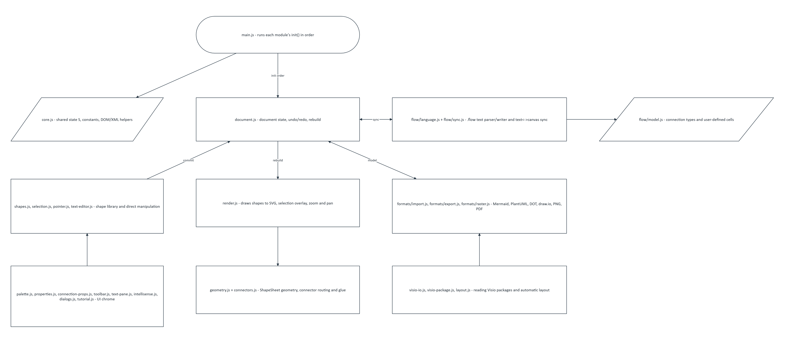
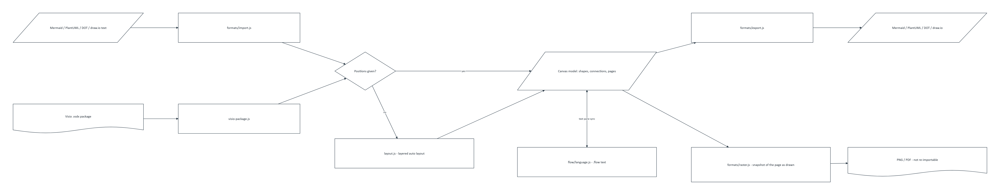
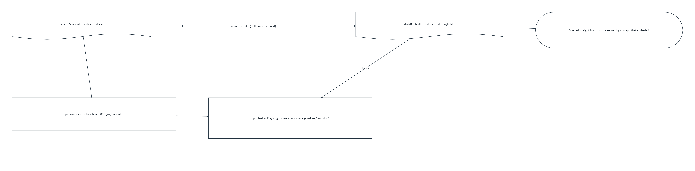
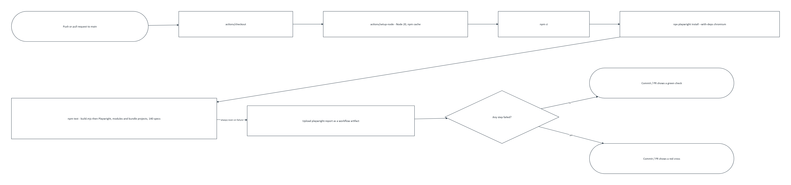

# RoutesFlow

A browser-based diagram editor. Drawings are stored as `.flow` text and can be imported from, and exported to, Mermaid, PlantUML, Graphviz DOT and draw.io; Visio (`.vsdx`) can be imported, one-way. A drawing can also be exported as PNG or PDF: PNG makes one picture per page (a zip of them, for more than one page), and PDF makes a single document with every page in it. Both are pictures, not diagram files, so they cannot be imported back. The Export dialog's File name field sets the name saved to disk, for every export type.

## Using it

Open `dist/Routesflow-editor.html` in a browser. It is a single self-contained file, so it works straight from disk.
A short guided tour opens on the first visit; the Tour button replays it.

Visio drawings come in through **Import** (choosing a `.vsdx` with Open, or dropping one on the page, opens the
Import dialog). Shapes keep their places and sizes, Visio's dynamic connectors keep their right-angled routes, and
the first page can go on a new page, replace this page or sit beside what is there. Icon shapes (SQL Server, screens,
code and similar Visio stencils) keep their artwork: the picture is stored once per distinct icon as an
`icon name "data:image/svg+xml;base64,..."` line under the `flow 1` header, and shapes use it with `[icon=name]`. The
shape keeps its nearest editor type, so text exports still work. Other Visio-only formatting is not kept. A connection's route (straight or right-angled) can be changed in the properties panel;
in the text it is `route=elbow`, with any imported bend points as `via="x,y x,y"` in mm.

Right-angled lines are edited as in Visio: select one and drag the square handle on any segment sideways; the end
handles re-attach either end. Moving a group of shapes moves the routes between them too; moving or resizing one
end keeps the bends and slides the one next to that end so the line stays square. A line without bends is routed
automatically, around other shapes. Lines are drawn beneath shapes.

Every shape has four snap points, at the middle of each side. Dragging a connection's end handle (or drawing a new
one in connect mode) near one sticks the line to that exact point — shown as a small circle, filled in once the
pointer is close enough — instead of the usual automatic glue, which always faces whichever shape is at the other
end. A line glued to a snap point stays on that side of the shape even after the shape is moved or resized. In the
text it is `beginpt=`/`endpt=` (n, e, s or w).

The text pane suggests what can come next as you type (IntelliSense): shape types after `id:`, connection types after
a shape id, the shapes on the page after a connection, settings inside `[ ]` and their values (the Routes palette for
colours), and page sizes and directions. Ctrl+Space opens the list anywhere; Enter or Tab accepts, Escape closes.

Text sizes come across from Visio (`size=8` in the text, in points) and can be set for any selection in the
properties panel. Text is measured as drawn, so words are only split when a single word is wider than its shape.

With nothing selected, the Page panel renames the page, sets an explicit width and height (in the text, `size
900x700`), offers presets for A1 to A5 and US Letter in both orientations, and Fit page to content sets that size
to whatever is actually on the page, with the same margin new content is placed with. Delete this page removes
the page outright (not just its content); the last remaining page cannot be deleted.

Choosing a size smaller than what is already on the page never moves, resizes or deletes anything: the page
itself stays at the size chosen, and whatever reaches past it is shown on a light grey background rather than
being forced to fit. A page with no explicit size still grows with its content, as a floor of A4 landscape. PNG
and PDF exports, and the page size written to a draw.io export, crop to the page's own size — the part shown in
grey will not be in them. Dragging a shape past the edge of a page with no explicit size still grows that page,
as it always has; dragging past the edge of an explicitly sized page just shows the shape in the grey area, the
same as anything else past that page.

## Diagrams

`examples/` holds generic `.flow` diagrams, unrelated to any particular project, showing what the format and the
shapes look like. `build-pipeline.flow` is a small CI-build process with a decision and a loop.

## How RoutesFlow works

`docs/diagrams/` holds `.flow` diagrams of RoutesFlow's own architecture, each exported to PNG with the editor's
own PNG export. Open the `.flow` source in RoutesFlow to explore or edit it.

**Module architecture** ([source](docs/diagrams/module-architecture.flow)) — how the ES modules listed under
Developing below relate to one another, with `document.js` as the hub that `main.js`, the `.flow` text pipeline,
the canvas renderer, direct-manipulation editing and the format importers/exporters all commit through.



**Import/export data flow** ([source](docs/diagrams/import-export-flow.flow)) — what happens to a drawing on the
way in (Mermaid/PlantUML/DOT/draw.io text or a Visio package, auto-laid-out if it carries no positions) and the
way out (back to those formats, or a one-way PNG/PDF snapshot that cannot be imported again).



**Build and deploy pipeline** ([source](docs/diagrams/build-deploy-pipeline.flow)) — from `src/` through
`npm run build` to the single-file `dist/Routesflow-editor.html`, opened straight from disk or served by any app
that embeds it; plus where `npm run serve` and the Playwright suite sit.



**Text pane / canvas sync** ([source](docs/diagrams/text-canvas-sync.flow)) — edits typed in the text pane and
edits dragged on the canvas both end up going through the same `document.js` commit, which is why undo/redo and
rebuild stay consistent regardless of which side you worked on.


**CI pipeline** ([source](docs/diagrams/ci-pipeline.flow)) — what `.github/workflows/tests.yml` runs on every push
or pull request to `main`: installs Chromium, runs the full Playwright suite against both the `modules` and
`bundle` projects, and uploads the HTML report as a workflow artifact regardless of the result.



## Developing

The source is split into an HTML page, a stylesheet and ES modules:

```
src/
  index.html             page markup
  css/flow-editor.css    styles
  js/main.js             entry point: runs each module's init() in order, then opens a blank drawing
  js/core.js             shared state (S), constants and small DOM/XML helpers
  js/visio-package.js    reading Visio packages; shape -> master -> style inheritance
  js/geometry.js         ShapeSheet geometry and transforms
  js/render.js           drawing shapes to SVG, selection overlay, zoom and pan
  js/connectors.js       connector routing and glue
  js/shapes.js           shape library and editing operations; database tables
  js/selection.js        multi-selection, delete, move, duplicate
  js/pointer.js          hit testing, hover, marquee, drag, resize, connect
  js/text-editor.js      in-place text editing
  js/palette.js          shape palette and drag-to-add
  js/properties.js       properties panel
  js/connection-props.js connection settings in the properties panel
  js/formats/export.js   graph model and exporters (Mermaid, PlantUML, DOT, draw.io)
  js/formats/import.js   importers for the same formats
  js/formats/raster.js   PNG and PDF export: a snapshot of the page as drawn, with a hand-built PDF wrapper
  js/layout.js           automatic layered layout for imports without positions
  js/dialogs.js          import and export dialogs
  js/flow/model.js       connection types and the user-defined cells the model is stored in
  js/flow/language.js    the .flow language parser and writer
  js/flow/sync.js        text to canvas and canvas to text
  js/document.js         document state, undo/redo and rebuild
  js/visio-io.js         Visio import, opening and saving files
  js/text-pane.js        the text pane
  js/toolbar.js          toolbar buttons and keyboard shortcuts
  js/tutorial.js         the guided tour
  js/intellisense.js     suggestions as you type in the text pane
```

Modules only declare things when imported. Anything that touches the page (event listeners, DOM lookups) is in the module's `init()`, and `main.js` calls those in a fixed order.

Browsers do not load ES modules from `file://`, so serve `src/` while developing:

```shell
npm install
npm run serve      # http://localhost:8000
```

After changing anything in `src/`, rebuild the single-file copy and commit it with the source:

```shell
npm run build      # writes dist/Routesflow-editor.html
```

## Testing

End-to-end tests use Playwright and run every spec twice: against the modules in `src/` (served by
`build.mjs --serve`) and against the single-file `dist/flow-editor.html` opened from disk. JSZip is served from
`node_modules` instead of the CDN, so the tests work offline.

```shell
npm install
npx playwright install chromium   # first time only
npm test                          # builds, then runs tests/e2e
npm run test:ui                   # Playwright's interactive runner
```

`tests/e2e/fixtures.js` holds a small page object (`FlowApp`) that drives the editor through its UI only:
find shapes by their text, click, drag, read the selection title. Specs fail on any uncaught page error.
`tests/fixtures/visio-flowchart.vsdx` is a real Visio flowchart with every label replaced by a placeholder, the
author details removed, and its icon-stencil artwork replaced with plain shapes drawn for this project.

## License

[PolyForm Noncommercial 1.0.0](LICENSE.md) — free to use, modify and share for any noncommercial purpose; not for
commercial use or resale.
